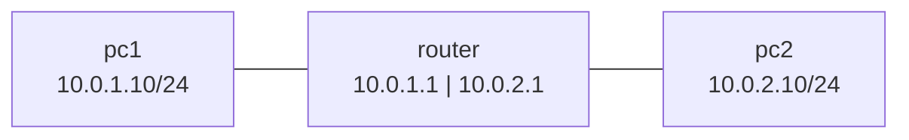

# Lab 1 · Hai mạng và một router

Dựng 2 subnet và một router bằng **network namespace**: mỗi namespace là một "máy" độc lập có card mạng, IP, bảng định tuyến riêng.

> Tự gây ra rồi tự sửa 3 lỗi kinh điển: thiếu gateway, router không chuyển tiếp gói, và thấy gói đi qua router bằng `traceroute`.

<p class="related">Kiến thức: <a href="#/mang?id=chia-subnet">Chia subnet</a> · <a href="#/mang?id=kiem-tra-5-buoc">Quy trình kiểm tra 5 bước</a></p>

## Sơ đồ :id=so-do



## Làm mẫu :id=lam-mau

### 1 · Tạo 3 máy và nối dây :id=buoc-1

```bash
sudo ip netns add pc1
sudo ip netns add pc2
sudo ip netns add router
sudo ip link add veth-pc1 type veth peer name veth-r1      # dây pc1 ↔ router
sudo ip link add veth-pc2 type veth peer name veth-r2      # dây pc2 ↔ router
sudo ip link set veth-pc1 netns pc1
sudo ip link set veth-r1 netns router
sudo ip link set veth-pc2 netns pc2
sudo ip link set veth-r2 netns router
```

### 2 · Đặt IP và bật card mạng :id=buoc-2

```bash
sudo ip -n pc1 addr add 10.0.1.10/24 dev veth-pc1
sudo ip -n pc2 addr add 10.0.2.10/24 dev veth-pc2
sudo ip -n router addr add 10.0.1.1/24 dev veth-r1
sudo ip -n router addr add 10.0.2.1/24 dev veth-r2
sudo ip -n pc1 link set veth-pc1 up
sudo ip -n pc2 link set veth-pc2 up
sudo ip -n router link set veth-r1 up
sudo ip -n router link set veth-r2 up
```

### 3 · Lỗi 1: thiếu gateway :id=buoc-3

```bash
sudo ip netns exec pc1 ping -c 2 10.0.2.10
```

```
ping: connect: Network is unreachable
```

pc1 chỉ biết mạng `10.0.1.0/24` của nó, không biết gửi gói tới `10.0.2.x` qua đâu. Thêm gateway cho cả hai máy:

```bash
sudo ip -n pc1 route add default via 10.0.1.1
sudo ip -n pc2 route add default via 10.0.2.1
```

### 4 · Lỗi 2: router không chuyển tiếp gói :id=buoc-4

Linux mặc định **không** chuyển tiếp gói giữa các card mạng. Tắt chủ động để chắc chắn thấy lỗi:

```bash
sudo ip netns exec router sysctl -w net.ipv4.ip_forward=0
sudo ip netns exec pc1 ping -c 2 -W 1 10.0.2.10
```

```
2 packets transmitted, 0 received, 100% packet loss
```

Khác lỗi 1: lần này gói **đã đi** (không báo unreachable) nhưng không có trả lời, vì router nhận gói rồi bỏ.

### 5 · Bật chuyển tiếp: thông :id=buoc-5

```bash
sudo ip netns exec router sysctl -w net.ipv4.ip_forward=1
sudo ip netns exec pc1 ping -c 2 10.0.2.10
sudo ip netns exec pc1 traceroute -n 10.0.2.10
```

```
2 packets transmitted, 2 received, 0% packet loss
traceroute to 10.0.2.10 (10.0.2.10), 30 hops max, 60 byte packets
 1  10.0.1.1  0.099 ms  0.005 ms  0.002 ms
 2  10.0.2.10  0.024 ms  0.003 ms  0.007 ms
```

Hop 1 là router, hop 2 là đích: gói đã đi qua router.

## Tự làm :id=tu-lam

Thêm máy `pc3` ở mạng `10.0.3.0/24`, nối vào router, để pc1 ping được pc3.

<details>
<summary>Đáp án</summary>

```bash
sudo ip netns add pc3
sudo ip link add veth-pc3 type veth peer name veth-r3
sudo ip link set veth-pc3 netns pc3
sudo ip link set veth-r3 netns router
sudo ip -n pc3 addr add 10.0.3.10/24 dev veth-pc3
sudo ip -n router addr add 10.0.3.1/24 dev veth-r3
sudo ip -n pc3 link set veth-pc3 up
sudo ip -n router link set veth-r3 up
sudo ip -n pc3 route add default via 10.0.3.1
sudo ip netns exec pc1 ping -c 2 10.0.3.10
```

Router đã bật chuyển tiếp và có sẵn route tới mạng gắn trực tiếp, nên chỉ cần gateway cho pc3.

</details>

## Dọn dẹp :id=don-dep

```bash
sudo ip netns del pc1
sudo ip netns del pc2
sudo ip netns del router
sudo ip netns del pc3      # nếu đã làm phần Tự làm
```

Xoá namespace là xoá luôn dây `veth` gắn trong đó.

## Cần nhớ :id=can-nho

1. `Network is unreachable` = máy không có route tới đích (thường thiếu gateway).
2. Gói đi mà không có trả lời qua router = router chưa bật chuyển tiếp, hoặc chiều về thiếu route.
3. `traceroute` cho thấy gói đi qua những router nào: dừng ở đâu là hỏng ở đó.

## Nguồn tham khảo :id=nguon

- [ip-netns(8)](https://manpages.ubuntu.com/manpages/noble/en/man8/ip-netns.8.html) · [ip(8)](https://manpages.ubuntu.com/manpages/noble/en/man8/ip.8.html)
