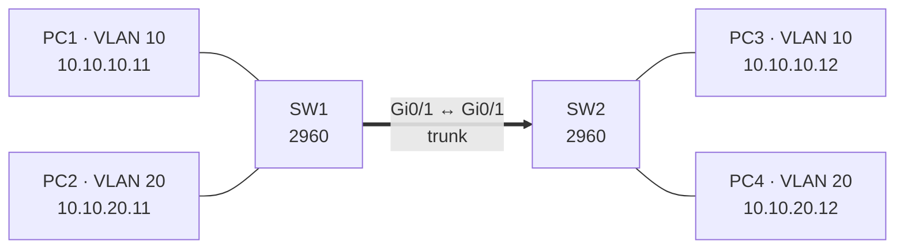

# Lab 6 · VLAN trên switch Cisco

Dựng 2 switch, 2 VLAN, một đường trunk trong **Cisco Packet Tracer**, rồi cho hai VLAN nói chuyện với nhau qua router.

> Cấu hình được cổng access, trunk; kiểm tra bằng `show`; hiểu vì sao khác VLAN thì không ping được cho tới khi có router.

<p class="related">Kiến thức: <a href="#/mang?id=vlan">VLAN</a> · <a href="#/thiet-bi-mang?id=cong-access">Cổng access</a> · <a href="#/thiet-bi-mang?id=cong-trunk">Cổng trunk</a></p>

?> Bài này làm trong [Cisco Packet Tracer](https://www.netacad.com/cisco-packet-tracer) (miễn phí với tài khoản Networking Academy). Lệnh theo tài liệu Cisco IOS; sổ tay chưa chạy thử trên switch thật.

## Sơ đồ :id=so-do



| Máy | Cổng | VLAN | IP / mask |
|---|---|---|---|
| PC1 | SW1 Fa0/1 | 10 | 10.10.10.11 /24 |
| PC2 | SW1 Fa0/2 | 20 | 10.10.20.11 /24 |
| PC3 | SW2 Fa0/1 | 10 | 10.10.10.12 /24 |
| PC4 | SW2 Fa0/2 | 20 | 10.10.20.12 /24 |

## Làm mẫu :id=lam-mau

### 1 · Tạo VLAN và cổng access (làm trên cả SW1 và SW2) :id=access

```
enable
configure terminal
vlan 10
 name VANPHONG
vlan 20
 name XUONG
interface fa0/1
 switchport mode access
 switchport access vlan 10
interface fa0/2
 switchport mode access
 switchport access vlan 20
end
```

### 2 · Trunk giữa hai switch (cả SW1 và SW2) :id=trunk

```
configure terminal
interface gi0/1
 switchport mode trunk
 switchport trunk allowed vlan 10,20
end
write memory
```

### 3 · Kiểm tra :id=kiem-tra

`show vlan brief`:

```
VLAN Name                             Status    Ports
---- -------------------------------- --------- -------------------------------
1    default                          active    Fa0/3, Fa0/4, …
10   VANPHONG                         active    Fa0/1
20   XUONG                            active    Fa0/2
```

`show interfaces trunk` phải thấy `Gi0/1` ở trạng thái `trunking`, cho phép VLAN `10,20`.

| Ping | Kết quả | Vì sao |
|---|---|---|
| PC1 → PC3 | Thông | Cùng VLAN 10, đi qua trunk |
| PC2 → PC4 | Thông | Cùng VLAN 20 |
| PC1 → PC2 | **Không thông** | Khác VLAN, khác subnet, chưa có router |

## Tự làm :id=tu-lam

Thêm một router 2911 nối vào cổng `Fa0/24` của SW1 để PC1 ping được PC2 (định tuyến giữa các VLAN bằng một cổng router, kiểu "router-on-a-stick"). Gợi ý: cổng switch nối router là trunk; router dùng cổng con (subinterface) cho từng VLAN; gateway của PC là IP `.1` của mạng tương ứng.

<details>
<summary>Đáp án</summary>

Trên SW1:

```
configure terminal
interface fa0/24
 switchport mode trunk
 switchport trunk allowed vlan 10,20
end
```

Trên router:

```
configure terminal
interface gi0/0
 no shutdown
interface gi0/0.10
 encapsulation dot1Q 10
 ip address 10.10.10.1 255.255.255.0
interface gi0/0.20
 encapsulation dot1Q 20
 ip address 10.10.20.1 255.255.255.0
end
write memory
```

Đặt gateway: PC1, PC3 là `10.10.10.1`; PC2, PC4 là `10.10.20.1`. Kiểm tra trên router: `show ip interface brief` (các cổng con `up`), `show ip route` (có hai mạng `C` gắn trực tiếp).

</details>

## Cần nhớ :id=can-nho

1. Cổng nối máy: `switchport mode access` + `switchport access vlan <số>`.
2. Cổng nối switch/router: `switchport mode trunk`; thêm VLAN vào trunk đang chạy phải dùng `add`.
3. Khác VLAN muốn nói chuyện phải có thiết bị lớp 3 (router, switch lớp 3, firewall) và gateway đúng trên máy.

## Nguồn tham khảo :id=nguon

- Cisco — [Catalyst command references](https://www.cisco.com/c/en/us/support/switches/catalyst-9300-series-switches/products-command-reference-list.html) · [Cisco Packet Tracer](https://www.netacad.com/cisco-packet-tracer)
- IEEE — [802.1Q](https://standards.ieee.org/ieee/802.1Q/10323/)
