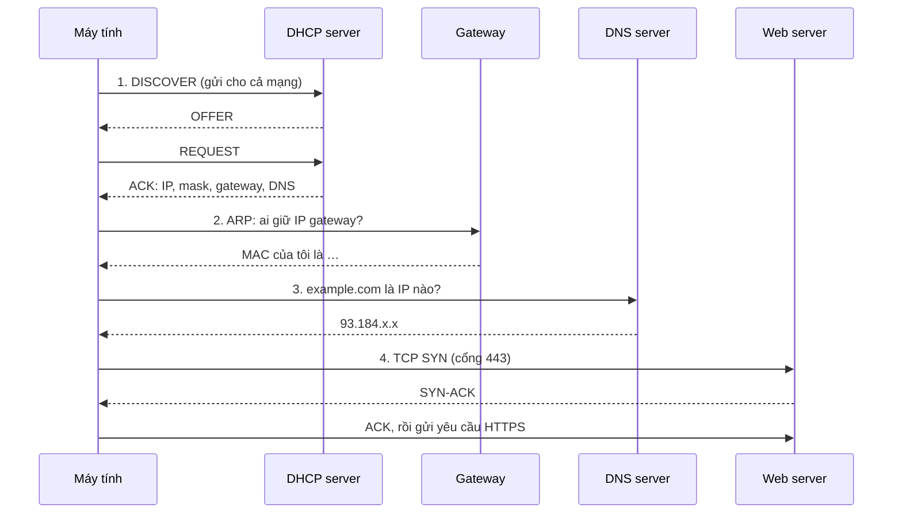
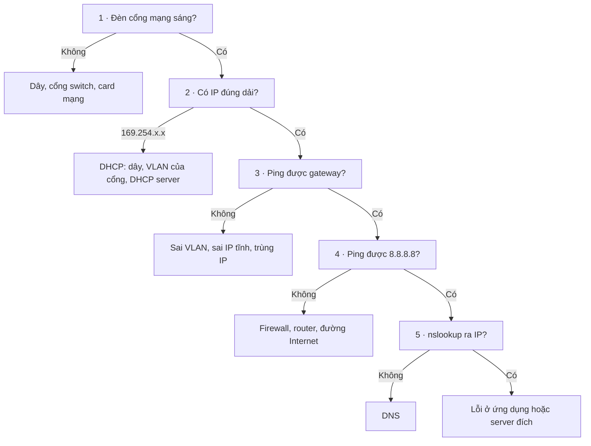

# Mạng

Nền tảng để chẩn đoán mọi sự cố: một máy vào mạng diễn ra thế nào, địa chỉ IP, subnet, cổng, và lệnh kiểm tra trên từng hệ điều hành.

> Nhìn triệu chứng là biết lỗi nằm ở bước nào; chia subnet không cần máy tính; kiểm tra mạng theo đúng thứ tự trên Linux, Windows, macOS và Cisco.

<p class="related">Liên quan: <a href="#/xu-ly-su-co?id=su-co-1">Máy không vào mạng</a> · <a href="#/windows?id=mang">Lệnh mạng trên Windows</a> · <a href="#/thiet-bi-mang">Switch &amp; VLAN</a></p>

## Mô hình TCP/IP :id=tcp-ip

| Tầng | Gồm | Kiểm tra bằng |
|---|---|---|
| 4 · Ứng dụng | HTTP, DNS, SMB, RDP, SSH | `curl`, `nslookup`, mở thử dịch vụ |
| 3 · Giao vận | TCP, UDP, **cổng** | `nc -zv`, `Test-NetConnection` |
| 2 · Mạng | **IP**, định tuyến, ICMP | `ping`, `traceroute` |
| 1 · Liên kết | Dây, Wi-Fi, switch, **MAC**, **VLAN** | Đèn cổng mạng, `ip link`, `show interfaces` |

## Từ lúc cắm dây đến lúc mở được web



Mỗi bước hỏng cho ra **một triệu chứng riêng**:

| Bước hỏng | Triệu chứng | Kiểm tra |
|---|---|---|
| 1 · DHCP | Máy tự đặt IP `169.254.x.x` | `ipconfig` · `ip a` |
| 2 · ARP / gateway | Có IP đúng nhưng không ping được gateway | `ping <gateway>` · `arp -a` |
| 3 · DNS | Ping được `8.8.8.8`, không vào được web theo tên | `nslookup <tên>` |
| 4 · TCP | `Connection refused` (cổng đóng) hoặc `timed out` (bị chặn) | `nc -zv <ip> <cổng>` |

?> `169.254.0.0/16` là dải **link-local** (RFC 3927): máy tự gán khi không xin được IP từ DHCP. Thấy dải này là biết ngay lỗi nằm ở bước 1, không cần kiểm tra gì thêm ở trên.

## Địa chỉ đặc biệt

| Dải | Ý nghĩa | Chuẩn |
|---|---|---|
| `10.0.0.0/8` · `172.16.0.0/12` · `192.168.0.0/16` | IP nội bộ, không định tuyến ra Internet | RFC 1918 |
| `127.0.0.0/8` | Chính máy mình (loopback) | — |
| `169.254.0.0/16` | Tự gán khi không có DHCP | RFC 3927 |
| `100.64.0.0/10` | Nhà mạng dùng NAT nhiều tầng (CGNAT) | RFC 6598 |

?> WAN của router công ty nhận IP dải `100.64.x.x` nghĩa là nhà mạng đang NAT thêm một tầng: từ ngoài **không mở port vào được**, VPN site-to-site cũng gặp khó. Cần yêu cầu nhà mạng cấp IP công khai (public IP).

## Chia subnet :id=chia-subnet

| CIDR | Subnet mask | Bước nhảy | Số máy dùng được |
|---|---|---|---|
| /24 | 255.255.255.**0** | 256 | 254 |
| /25 | 255.255.255.**128** | 128 | 126 |
| /26 | 255.255.255.**192** | 64 | 62 |
| /27 | 255.255.255.**224** | 32 | 30 |
| /28 | 255.255.255.**240** | 16 | 14 |
| /29 | 255.255.255.**248** | 8 | 6 |
| /30 | 255.255.255.**252** | 4 | 2 |

**Cách tính nhanh bằng bước nhảy:**

1. Bước nhảy = 256 − số cuối của mask. Ví dụ `/26` → 256 − 192 = **64**.
2. Các mạng bắt đầu ở bội số của bước nhảy: `.0`, `.64`, `.128`, `.192`.
3. Broadcast = địa chỉ mạng kế tiếp − 1. Máy dùng được nằm giữa hai địa chỉ đó.

**Ví dụ:** `192.168.10.77/26` thuộc mạng nào?

| | Kết quả |
|---|---|
| 77 nằm giữa 64 và 128 | Mạng `192.168.10.64` |
| Máy dùng được | `.65` → `.126` |
| Broadcast | `.127` |

Số máy = 2^(32 − CIDR) − 2, vì trừ địa chỉ mạng và địa chỉ broadcast.

## Cổng hay gặp

| Cổng | Giao thức | Dịch vụ | | Cổng | Giao thức | Dịch vụ |
|---|---|---|---|---|---|---|
| 22 | TCP | SSH | | 445 | TCP | SMB (chia sẻ Windows) |
| 53 | UDP, TCP | DNS | | 502 | TCP | Modbus TCP |
| 67 / 68 | UDP | DHCP | | 554 | TCP | RTSP (camera) |
| 80 / 443 | TCP | HTTP / HTTPS | | 1433 | TCP | SQL Server |
| 88 | TCP, UDP | Kerberos (đăng nhập domain) | | 3306 | TCP | MySQL |
| 123 | UDP | NTP (đồng bộ giờ) | | 3389 | TCP | Remote Desktop |
| 161 | UDP | SNMP (giám sát thiết bị) | | 5432 | TCP | PostgreSQL |
| 389 / 636 | TCP | LDAP / LDAPS | | 8080 | TCP | Web phụ, proxy |

## Lệnh tương đương giữa các hệ điều hành :id=lenh-tuong-duong

| Việc | Linux | Windows | macOS | Cisco |
|---|---|---|---|---|
| Xem IP | `ip -br a` | `ipconfig /all` | `ifconfig` | `show ip interface brief` |
| Bảng định tuyến | `ip route` | `route print` | `netstat -rn` | `show ip route` |
| Đường đi | `traceroute <ip>` | `tracert <ip>` | `traceroute <ip>` | `traceroute <ip>` |
| Đường đi kèm tỉ lệ mất gói | `mtr -rwc 50 <ip>` | `pathping <ip>` | `mtr -rwc 50 <ip>` | — |
| Tra DNS | `dig <tên>` | `nslookup <tên>` | `dig <tên>` | — |
| IP ↔ MAC (ARP) | `ip neigh` | `arp -a` | `arp -a` | `show arp` |
| Cổng đang mở | `ss -tulpn` | `netstat -ano` | `lsof -nP -iTCP -sTCP:LISTEN` | — |
| Thử kết nối tới cổng | `nc -zv <ip> <cổng>` | `Test-NetConnection <ip> -Port <cổng>` | `nc -zv <ip> <cổng>` | `telnet <ip> <cổng>` |
| Xin lại IP | `sudo networkctl renew <card>` | `ipconfig /release` → `/renew` | `sudo ipconfig set en0 DHCP` | — |
| Xoá cache DNS | `resolvectl flush-caches` | `ipconfig /flushdns` | `sudo dscacheutil -flushcache` | — |

## Quy trình kiểm tra 5 bước :id=kiem-tra-5-buoc



## Bắt gói tin

```bash
sudo tcpdump -i any -nn host 192.168.1.10      # mọi gói của một máy, không đổi IP sang tên
sudo tcpdump -i any -nn port 53                # chỉ DNS
sudo tcpdump -i any -nn 'tcp[tcpflags] & tcp-rst != 0'   # chỉ gói bị từ chối (RST)
sudo tcpdump -i any -w capture.pcap            # ghi ra file, mở bằng Wireshark
```

| Bộ lọc Wireshark | Hiện |
|---|---|
| `ip.addr == 192.168.1.10` | Gói đi hoặc đến máy này |
| `dhcp` | Quá trình xin IP (thấy được bước nào không có trả lời) |
| `dns` | Truy vấn DNS |
| `arp.duplicate-address-detected` | **Trùng IP** |
| `tcp.analysis.retransmission` | Gói phải gửi lại: mạng chập chờn, mất gói |
| `tcp.flags.reset == 1` | Kết nối bị từ chối hoặc cắt ngang |

## Bài lab: dựng mạng 2 máy

Trong máy `lab` (`orb -m lab`), **network namespace** tạo ra 2 "máy" độc lập, nối bằng một sợi dây ảo `veth`:

```bash
sudo ip netns add a                                      # máy a
sudo ip netns add b                                      # máy b
sudo ip link add veth-a type veth peer name veth-b       # dây ảo 2 đầu
sudo ip link set veth-a netns a                          # cắm một đầu vào máy a
sudo ip link set veth-b netns b                          # đầu kia vào máy b
sudo ip -n a addr add 10.0.0.1/24 dev veth-a
sudo ip -n b addr add 10.0.0.2/24 dev veth-b
sudo ip -n a link set veth-a up
sudo ip -n b link set veth-b up
sudo ip netns exec a ping -c 3 10.0.0.2                  # thông
sudo ip netns del a && sudo ip netns del b               # dọn dẹp
```

Đổi IP máy b sang `10.0.1.2/24` rồi ping lại sẽ báo `Network is unreachable`: **khác subnet** thì phải có router mới nói chuyện được.

## Cần nhớ :id=can-nho

1. Một máy vào mạng đi qua 4 bước **DHCP → ARP → DNS → TCP**; mỗi bước hỏng cho ra một triệu chứng riêng.
2. `169.254.x.x` = không xin được IP · ping được `8.8.8.8` mà không vào web theo tên = lỗi DNS.
3. Kiểm tra **từ dưới lên**: dây → IP → gateway → Internet → DNS. Không nhảy cóc.

## Nguồn tham khảo :id=nguon

- IETF — [RFC 1918](https://www.rfc-editor.org/rfc/rfc1918) (IP nội bộ) · [RFC 3927](https://www.rfc-editor.org/rfc/rfc3927) (link-local) · [RFC 6598](https://www.rfc-editor.org/rfc/rfc6598) (CGNAT) · [RFC 4632](https://www.rfc-editor.org/rfc/rfc4632) (CIDR)
- IETF — [RFC 2131](https://www.rfc-editor.org/rfc/rfc2131) (DHCP) · [RFC 1034](https://www.rfc-editor.org/rfc/rfc1034) (DNS) · [RFC 9293](https://www.rfc-editor.org/rfc/rfc9293) (TCP)
- IANA — [Service Name and Port Number Registry](https://www.iana.org/assignments/service-names-port-numbers/service-names-port-numbers.xhtml)
- [tcpdump(1)](https://www.tcpdump.org/manpages/tcpdump.1.html) · [Wireshark Display Filter Reference](https://www.wireshark.org/docs/dfref/) · [ip-netns(8)](https://manpages.ubuntu.com/manpages/noble/en/man8/ip-netns.8.html)
