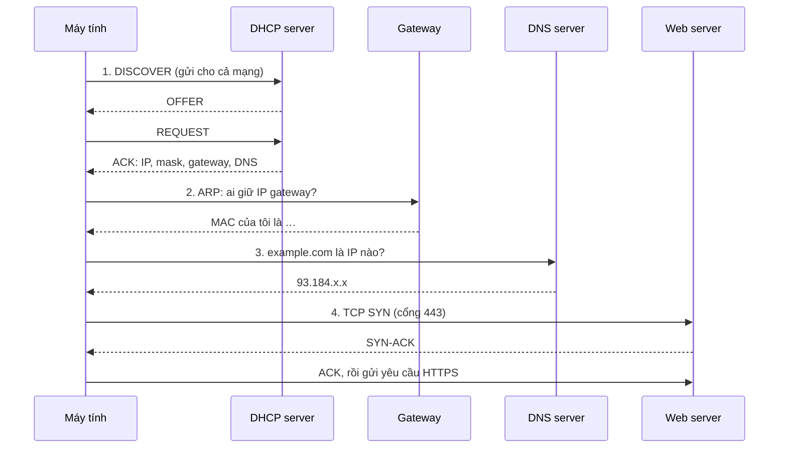
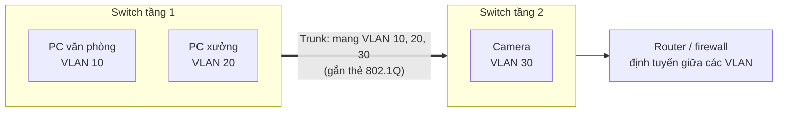
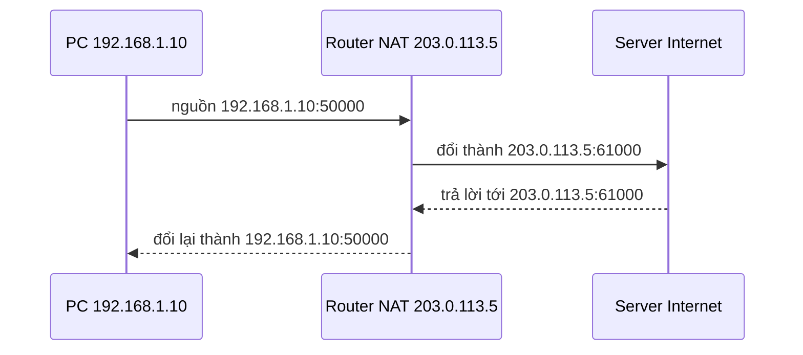
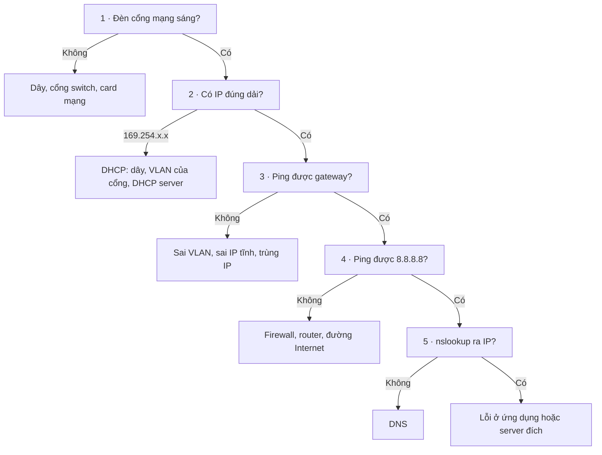

# Mạng

Nền tảng để chẩn đoán mọi sự cố: một máy vào mạng diễn ra thế nào, địa chỉ, VLAN, NAT, và lệnh kiểm tra trên từng hệ điều hành.

> Nhìn triệu chứng là biết lỗi nằm ở bước nào; chia subnet không cần máy tính; giải thích được VLAN và NAT; kiểm tra mạng đúng thứ tự trên mọi hệ điều hành.

<p class="related">Liên quan: <a href="#/xu-ly-su-co?id=su-co-1">Máy không vào mạng</a> · <a href="#/thiet-bi-mang?id=cong-access">Cấu hình VLAN trên switch</a> · <a href="#/lab/01-mang-hai-may">Lab 1: hai mạng và một router</a></p>

## Hiểu :id=hieu

### Mô hình TCP/IP :id=tcp-ip

| Tầng | Gồm | Kiểm tra bằng |
|---|---|---|
| 4 · Ứng dụng | HTTP, DNS, SMB, RDP, SSH | `curl`, `nslookup`, mở thử dịch vụ |
| 3 · Giao vận | TCP, UDP, **cổng** | `nc -zv`, `Test-NetConnection` |
| 2 · Mạng | **IP**, định tuyến, ICMP | `ping`, `traceroute` |
| 1 · Liên kết | Dây, Wi-Fi, switch, **MAC**, **VLAN** | Đèn cổng mạng, `ip link`, `show interfaces` |

Mỗi tầng chỉ làm được việc khi tầng dưới đã chạy. Vì vậy sự cố luôn kiểm tra **từ dưới lên**.

### Từ lúc cắm dây đến lúc mở được web :id=luong-ket-noi



| Bước hỏng | Triệu chứng | Kiểm tra |
|---|---|---|
| 1 · DHCP | Máy tự đặt IP `169.254.x.x` | `ipconfig` · `ip a` |
| 2 · ARP / gateway | Có IP đúng nhưng không ping được gateway | `ping <gateway>` · `arp -a` |
| 3 · DNS | Ping được `8.8.8.8`, không vào được web theo tên | `nslookup <tên>` |
| 4 · TCP | `Connection refused` (cổng đóng) hoặc `timed out` (bị chặn) | `nc -zv <ip> <cổng>` |

?> `169.254.0.0/16` là dải **link-local** (RFC 3927): máy tự gán khi không xin được IP từ DHCP. Thấy dải này là biết ngay lỗi ở bước 1.

### Địa chỉ đặc biệt :id=dia-chi-dac-biet

| Dải | Ý nghĩa | Chuẩn |
|---|---|---|
| `10.0.0.0/8` · `172.16.0.0/12` · `192.168.0.0/16` | IP nội bộ, không định tuyến ra Internet | RFC 1918 |
| `127.0.0.0/8` | Chính máy mình (loopback) | — |
| `169.254.0.0/16` | Tự gán khi không có DHCP | RFC 3927 |
| `100.64.0.0/10` | Nhà mạng NAT nhiều tầng (CGNAT) | RFC 6598 |

?> WAN của router công ty nhận IP `100.64.x.x` nghĩa là nhà mạng đang NAT thêm một tầng: từ ngoài **không mở port vào được**, VPN site-to-site cũng gặp khó. Cần yêu cầu nhà mạng cấp IP công khai.

### Chia subnet :id=chia-subnet

| CIDR | Subnet mask | Bước nhảy | Số máy dùng được |
|---|---|---|---|
| /24 | 255.255.255.**0** | 256 | 254 |
| /25 | 255.255.255.**128** | 128 | 126 |
| /26 | 255.255.255.**192** | 64 | 62 |
| /27 | 255.255.255.**224** | 32 | 30 |
| /28 | 255.255.255.**240** | 16 | 14 |
| /29 | 255.255.255.**248** | 8 | 6 |
| /30 | 255.255.255.**252** | 4 | 2 |

**Cách tính bằng bước nhảy:**

1. Bước nhảy = 256 − số cuối của mask. Ví dụ `/26` → 256 − 192 = **64**.
2. Các mạng bắt đầu ở bội số của bước nhảy: `.0`, `.64`, `.128`, `.192`.
3. Broadcast = địa chỉ mạng kế tiếp − 1; máy dùng được nằm giữa.

**Ví dụ:** `192.168.10.77/26` → 77 nằm giữa 64 và 128 → mạng `.64`, máy dùng được `.65`–`.126`, broadcast `.127`.

### VLAN :id=vlan

VLAN chia **một switch vật lý thành nhiều mạng riêng**. Máy ở VLAN 10 và VLAN 20 cắm chung một switch nhưng không thấy nhau, muốn nói chuyện phải đi qua router hoặc firewall, nơi kiểm soát được ai được vào đâu.



| Loại cổng | Nối với | Gói tin |
|---|---|---|
| **Access** | Máy tính, máy in, camera | Thuộc **một** VLAN, không gắn thẻ |
| **Trunk** | Switch khác, router, firewall | Mang **nhiều** VLAN, mỗi gói gắn thẻ 802.1Q ghi số VLAN |

Thẻ 802.1Q dài 4 byte, trong đó 12 bit là số VLAN: dùng được từ **1 đến 4094**.

!> Máy cắm vào cổng **sai VLAN** vẫn sáng đèn, vẫn "có mạng", nhưng nhận IP của dải khác hoặc `169.254.x.x`. Đây là lỗi rất hay gặp sau khi đổi chỗ ngồi hoặc đổi cổng switch.

### NAT :id=nat

Máy nội bộ dùng IP riêng (RFC 1918), không đi thẳng ra Internet được. Router **đổi IP nguồn** thành IP công khai của nó khi gói đi ra, rồi đổi ngược lại khi gói trả lời quay về.



| Hệ quả | Vì sao |
|---|---|
| Nhiều máy dùng chung một IP công khai | Router phân biệt bằng **cổng** (gọi là PAT) |
| Từ ngoài **không kết nối vào** máy nội bộ được | Router không biết chuyển gói tới máy nào, trừ khi cấu hình **port forward** |
| Camera, NAS muốn xem từ xa | Cần port forward, hoặc tốt hơn là **VPN** |

## Làm :id=lam

### Quy trình kiểm tra 5 bước :id=kiem-tra-5-buoc



### Bắt gói tin :id=bat-goi-tin

```bash
sudo tcpdump -i any -nn host 192.168.1.10                # mọi gói của một máy
sudo tcpdump -i any -nn port 53                          # chỉ DNS
sudo tcpdump -i any -nn 'tcp[tcpflags] & tcp-rst != 0'   # chỉ gói bị từ chối (RST)
sudo tcpdump -i any -w capture.pcap                      # ghi ra file, mở bằng Wireshark
```

| Bộ lọc Wireshark | Hiện |
|---|---|
| `ip.addr == 192.168.1.10` | Gói đi hoặc đến máy này |
| `dhcp` | Quá trình xin IP: thấy bước nào không có trả lời |
| `dns` | Truy vấn DNS |
| `arp.duplicate-address-detected` | **Trùng IP** |
| `tcp.analysis.retransmission` | Gói phải gửi lại: mạng chập chờn, mất gói |
| `tcp.flags.reset == 1` | Kết nối bị từ chối hoặc cắt ngang |

Thực hành: [Lab 2 · Quan sát DNS và TCP](lab/02-quan-sat-goi-tin.md).

## Tra :id=tra

### Cổng hay gặp :id=cong

| Cổng | Giao thức | Dịch vụ | | Cổng | Giao thức | Dịch vụ |
|---|---|---|---|---|---|---|
| 22 | TCP | SSH | | 445 | TCP | SMB (chia sẻ Windows) |
| 53 | UDP, TCP | DNS | | 502 | TCP | Modbus TCP |
| 67 / 68 | UDP | DHCP | | 554 | TCP | RTSP (camera) |
| 80 / 443 | TCP | HTTP / HTTPS | | 1433 | TCP | SQL Server |
| 88 | TCP, UDP | Kerberos (đăng nhập domain) | | 3306 | TCP | MySQL |
| 123 | UDP | NTP (đồng bộ giờ) | | 3389 | TCP | Remote Desktop |
| 161 | UDP | SNMP (giám sát thiết bị) | | 5432 | TCP | PostgreSQL |
| 389 / 636 | TCP | LDAP / LDAPS | | 8080 | TCP | Web phụ, proxy |

### Lệnh tương đương giữa các hệ điều hành :id=lenh-tuong-duong

| Việc | Linux | Windows | macOS | Cisco |
|---|---|---|---|---|
| Xem IP | `ip -br a` | `ipconfig /all` | `ifconfig` | `show ip interface brief` |
| Bảng định tuyến | `ip route` | `route print` | `netstat -rn` | `show ip route` |
| Đường đi | `traceroute <ip>` | `tracert <ip>` | `traceroute <ip>` | `traceroute <ip>` |
| Đường đi kèm tỉ lệ mất gói | `mtr -rwc 50 <ip>` | `pathping <ip>` | `mtr -rwc 50 <ip>` | — |
| Tra DNS | `dig <tên>` | `nslookup <tên>` | `dig <tên>` | — |
| IP ↔ MAC (ARP) | `ip neigh` | `arp -a` | `arp -a` | `show arp` |
| Cổng đang mở | `ss -tulpn` | `netstat -ano` | `lsof -nP -iTCP -sTCP:LISTEN` | — |
| Thử kết nối tới cổng | `nc -zv <ip> <cổng>` | `Test-NetConnection <ip> -Port <cổng>` | `nc -zv <ip> <cổng>` | `telnet <ip> <cổng>` |
| Xin lại IP | `sudo networkctl renew <card>` | `ipconfig /release` → `/renew` | `sudo ipconfig set en0 DHCP` | — |
| Xoá cache DNS | `resolvectl flush-caches` | `ipconfig /flushdns` | `sudo dscacheutil -flushcache` | — |

## Tự kiểm tra :id=tu-kiem-tra

<details>
<summary>Máy có IP <code>169.254.20.7</code>. Lỗi nằm ở bước nào, kiểm tra gì trước?</summary>

Bước 1 (DHCP): máy không xin được IP. Kiểm tra dây và đèn cổng, cổng switch có đúng VLAN không, DHCP server còn chạy và dải IP còn trống không.

</details>

<details>
<summary><code>ping 8.8.8.8</code> được, nhưng mở <code>google.com</code> không được. Lỗi gì?</summary>

DNS. Kiểm tra bằng `nslookup google.com`; xem máy đang dùng DNS server nào trong `ipconfig /all`.

</details>

<details>
<summary><code>172.16.5.200/27</code> thuộc mạng nào, broadcast là gì?</summary>

`/27` → bước nhảy 32 → các mạng `.0, .32, … .192, .224`. 200 nằm giữa 192 và 224 → mạng `172.16.5.192`, máy dùng được `.193`–`.222`, broadcast `.223`.

</details>

<details>
<summary>Vì sao hai máy cắm chung một switch mà không ping được nhau?</summary>

Hai cổng thuộc **hai VLAN khác nhau** (hoặc hai máy khác subnet). Muốn nói chuyện phải qua router/firewall định tuyến giữa các VLAN.

</details>

<details>
<summary>Vì sao từ nhà không vào thẳng được camera ở công ty dù biết IP công khai của công ty?</summary>

Vì NAT: router không biết chuyển kết nối từ ngoài vào máy nội bộ nào. Cần port forward, hoặc an toàn hơn là kết nối VPN rồi truy cập bằng IP nội bộ.

</details>

## Cần nhớ :id=can-nho

1. Một máy vào mạng đi qua 4 bước **DHCP → ARP → DNS → TCP**; mỗi bước hỏng cho ra một triệu chứng riêng.
2. `169.254.x.x` = không xin được IP · ping được `8.8.8.8` mà không vào web theo tên = lỗi DNS.
3. Kiểm tra **từ dưới lên**: dây → IP → gateway → Internet → DNS. Không nhảy cóc.

## Nguồn tham khảo :id=nguon

- IETF — [RFC 1918](https://www.rfc-editor.org/rfc/rfc1918) (IP nội bộ) · [RFC 3927](https://www.rfc-editor.org/rfc/rfc3927) (link-local) · [RFC 6598](https://www.rfc-editor.org/rfc/rfc6598) (CGNAT) · [RFC 4632](https://www.rfc-editor.org/rfc/rfc4632) (CIDR) · [RFC 3022](https://www.rfc-editor.org/rfc/rfc3022) (NAT)
- IETF — [RFC 2131](https://www.rfc-editor.org/rfc/rfc2131) (DHCP) · [RFC 1034](https://www.rfc-editor.org/rfc/rfc1034) (DNS) · [RFC 9293](https://www.rfc-editor.org/rfc/rfc9293) (TCP)
- IEEE — [802.1Q: Bridges and Bridged Networks](https://standards.ieee.org/ieee/802.1Q/10323/) (VLAN)
- IANA — [Service Name and Port Number Registry](https://www.iana.org/assignments/service-names-port-numbers/service-names-port-numbers.xhtml)
- [tcpdump(1)](https://www.tcpdump.org/manpages/tcpdump.1.html) · [Wireshark Display Filter Reference](https://www.wireshark.org/docs/dfref/)
