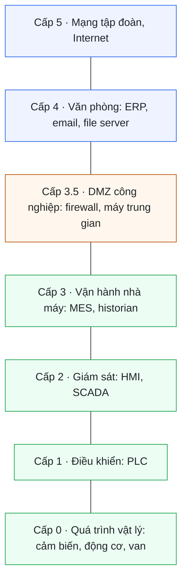
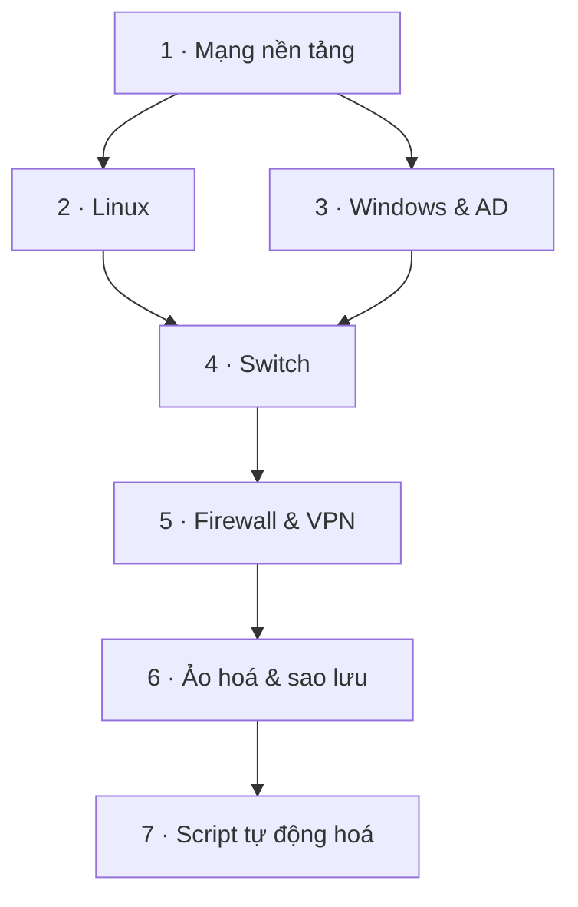

# Lộ trình nghề

Bản đồ nghề hệ thống & mạng, đặc biệt là IT trong nhà máy ở khu công nghiệp.

> Biết chọn vị trí nào, học theo thứ tự nào, chứng chỉ nào đáng thi, và hiểu vì sao mạng nhà máy phải chia tầng.

Liên quan: Bắt đầu học từ <a href="#/mang">02 · Mạng</a>

## Các vị trí

| Vị trí | Công việc chính | Phải thành thạo |
|---|---|---|
| **IT Helpdesk** | Máy tính, máy in, tài khoản, email, Wi-Fi | Windows, quy trình xử lý sự cố, giao tiếp |
| **System Admin – Windows** | Domain, phân quyền, file server, sao lưu, cập nhật | Active Directory, Group Policy, PowerShell, ảo hoá |
| **System Admin – Linux** | Server ứng dụng, database, giám sát | Bash, systemd, SSH, log, Docker |
| **Network Engineer** | Switch, router, firewall, VLAN, VPN, Wi-Fi | TCP/IP, Cisco CLI, firewall, Wireshark |
| **IT nhà máy** | Kiêm cả bốn vai trò trên, thường 1–3 người lo cả nhà máy | Tất cả ở trên, cộng camera, chấm công, ERP/MES |
| **OT / ICS** | Mạng điều khiển sản xuất: PLC, HMI, SCADA | Giao thức công nghiệp, phân vùng mạng, IEC 62443 |

## IT trong khu công nghiệp

- **Windows là chủ đạo:** domain Active Directory, file server, máy in mạng.
- **Nhiều vùng mạng (VLAN):** văn phòng, xưởng, kho, camera, Wi-Fi khách, máy móc sản xuất.
- **Hệ thống quanh sản xuất:** ERP, MES, máy chấm công, camera và đầu ghi, cân điện tử, máy in mã vạch.
- **Chạy 24/7 theo ca:** sự cố ban đêm vẫn phải xử lý, thường qua điện thoại hoặc truy cập từ xa.
- **Tuân thủ tập đoàn mẹ:** khoá USB, phân quyền dữ liệu, sao lưu, kiểm toán định kỳ.

?> Công ty FDI (Hàn, Nhật, Trung, Đài) thường yêu cầu báo cáo bằng tiếng Anh. Tiếng Anh kỹ thuật là kỹ năng bắt buộc, không phải điểm cộng.

## Mô hình Purdue: tách mạng IT và OT

Mạng nhà máy được chia **tầng**, theo mô hình Purdue (PERA). Đây là khung tham chiếu của bộ tiêu chuẩn an ninh công nghiệp **ISA/IEC 62443**. Nguyên tắc: **lưu lượng không được nhảy cóc** giữa các tầng, và mọi kết nối giữa mạng văn phòng (IT) và mạng sản xuất (OT) phải đi qua **DMZ công nghiệp**.

| Vùng | Ai quản lý | Ưu tiên số một |
|---|---|---|
| IT (cấp 4–5) | Phòng IT | Bảo mật dữ liệu |
| DMZ (cấp 3.5) | IT phối hợp OT | Kiểm soát mọi kết nối qua lại |
| OT (cấp 0–3) | Kỹ sư tự động hoá, OT | **Dây chuyền không được dừng** |

!> Ở mạng OT, khởi động lại thiết bị, cập nhật phần mềm hay quét mạng bằng `nmap` đều có thể làm dừng máy sản xuất. Không làm gì trên mạng OT khi chưa được kỹ sư phụ trách đồng ý.

## Thứ tự học

| # | Học | Đạt khi tự làm được |
|---|---|---|
| 1 | TCP/IP, subnet, DNS, DHCP, VLAN | Chia subnet bằng tay; giải thích từng bước một máy mở được trang web |
| 2 | Linux | SSH vào server, đọc log, quản lý dịch vụ, xử lý đầy ổ |
| 3 | Windows & Active Directory | Tạo user, phân quyền thư mục, áp Group Policy, tìm nguồn gây khoá tài khoản |
| 4 | Switch Cisco | Cấu hình VLAN và trunk, tìm một máy đang cắm ở cổng nào |
| 5 | Firewall & VPN | Viết policy, NAT, VPN cho nhân viên làm từ xa |
| 6 | Ảo hoá & sao lưu | Tạo máy ảo, sao lưu và **khôi phục thử thành công** |
| 7 | Bash, PowerShell, Python | Viết script thay cho việc lặp lại hằng ngày |

## Chứng chỉ

| Chứng chỉ | Mảng | Hình thức thi | Trang chính thức |
|---|---|---|---|
| **CCNA** | Mạng (Cisco) | Trắc nghiệm, mô phỏng | [cisco.com](https://www.cisco.com/site/us/en/learn/training-certifications/certifications/enterprise/ccna/index.html) |
| CompTIA Network+ | Mạng, không gắn hãng | Trắc nghiệm, câu hỏi thực hành | [comptia.org](https://www.comptia.org/certifications/network) |
| **RHCSA** | Linux (Red Hat) | **Thực hành trên máy thật** | [redhat.com](https://www.redhat.com/en/services/certification/rhcsa) |
| LPIC-1 | Linux, không gắn hãng | Trắc nghiệm | [lpi.org](https://www.lpi.org/our-certifications/lpic-1-overview/) |
| Fortinet FCA / FCP | Firewall FortiGate | Trắc nghiệm | [training.fortinet.com](https://training.fortinet.com/) |

?> Thứ tự hợp lý: **CCNA** (giá trị nhất khi xin việc mạng ở Việt Nam) → **RHCSA** (chứng minh làm được thật) → chứng chỉ của hãng thiết bị công ty đang dùng.

## Tự kiểm tra :id=tu-kiem-tra

Phòng IT muốn đọc dữ liệu sản lượng từ máy chủ MES để làm báo cáo trên ERP. Kết nối nên đi thế nào?

Qua **DMZ công nghiệp (cấp 3.5)**: ERP (cấp 4) không kết nối thẳng xuống MES (cấp 3). Dữ liệu được đẩy hoặc sao chép qua máy trung gian trong DMZ, có firewall kiểm soát cả hai phía.

Bạn muốn quét mạng xưởng bằng <code>nmap</code> để lập danh sách thiết bị. Cần làm gì trước?

Xin phép kỹ sư phụ trách OT và chọn thời điểm dây chuyền dừng. Một số PLC, thiết bị cũ có thể treo hoặc khởi động lại khi bị quét.

Mới vào nghề, nên thi chứng chỉ nào trước?

CCNA (hoặc Network+ nếu muốn trung lập): nền tảng mạng là gốc của mọi mảng khác, và CCNA được nhà tuyển dụng ở Việt Nam đánh giá cao nhất.

## Cần nhớ :id=can-nho

1. Ở nhà máy, **dây chuyền không được dừng** là ưu tiên số một: mọi thay đổi trên mạng OT phải được kỹ sư phụ trách đồng ý.
2. Học theo thứ tự **mạng → Linux/Windows → switch → firewall**: không vững mạng thì mọi thứ phía sau đều là học vẹt.
3. Chứng chỉ chứng minh kiến thức, **lab tự dựng** chứng minh làm được: cần cả hai.

## Nguồn tham khảo :id=nguon

- ISA — [ISA/IEC 62443 Series of Standards](https://www.isa.org/standards-and-publications/isa-standards/isa-iec-62443-series-of-standards)
- Trang chứng chỉ chính thức của Cisco, CompTIA, Red Hat, LPI, Fortinet (liên kết trong bảng trên)
