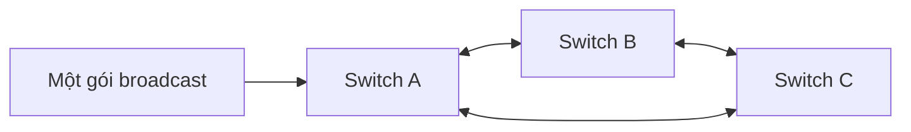

Switch Cisco IOS, HPE/Aruba và firewall FortiGate: hiểu cách switch chuyển gói, cấu hình VLAN, đọc lỗi cổng, lần dấu gói tin bị chặn.

> Hiểu vì sao một vòng dây làm tê liệt cả mạng; tìm một máy đang cắm ở cổng nào; cấu hình cổng access, trunk an toàn; biết vì sao firewall chặn một kết nối.

<p class="related">Liên quan: <a href="../mang/#vlan">VLAN là gì</a> · <a href="../xu-ly-su-co/#su-co-2">Cả khu mất mạng</a> · <a href="../xu-ly-su-co/#su-co-10">Camera mất hình</a> · <a href="../lab/06-vlan-cisco/">Lab 6: VLAN trên Cisco</a></p>

## Hiểu {#hieu}
### Switch học địa chỉ MAC thế nào {#hoc-mac}
| Bước | Switch làm gì |
|---|---|
| 1 · Học | Gói đi vào cổng 5 từ MAC `aa:aa` → ghi vào bảng: `aa:aa` ở cổng 5 |
| 2 · Chuyển | Gói gửi tới MAC đã có trong bảng → chỉ đẩy ra đúng cổng đó |
| 3 · Phát tràn | Gói gửi tới MAC **chưa biết**, hoặc gói broadcast → đẩy ra **mọi cổng** trong VLAN |

Bảng này chính là thứ `show mac address-table` hiển thị. Nhờ nó, bạn tìm được một máy đang cắm ở cổng nào chỉ từ địa chỉ MAC.

### Vì sao một vòng dây làm sập cả mạng {#vong-lap}


Gói broadcast bị phát tràn ra mọi cổng → đi vòng A → B → C → A **mãi mãi**, nhân bản liên tục cho tới khi băng thông và CPU switch cạn kiệt (gọi là **bão broadcast**). **Spanning Tree (STP)** ngăn điều này bằng cách tự **khoá bớt một cổng** để mạng không còn vòng.

:::caution
Vòng lặp thường do người dùng gây ra: cắm hai đầu một sợi dây vào cùng switch, hoặc cắm switch mini thành vòng. STP chỉ bảo vệ được khi được bật đúng trên mọi switch.
:::

## Làm {#lam}
### Trước khi sửa thiết bị mạng {#truoc-khi-sua}
1. **Xem trước, sửa sau:** chạy `show` để hiểu hiện trạng.
2. **Sao lưu cấu hình**, ghi lại sẽ sửa gì và vì sao.
3. **Mỗi lần một thay đổi**, kiểm tra xong mới làm tiếp.

:::caution
Sửa từ xa thì cẩn thận với **cổng uplink và VLAN quản trị** đang dùng để kết nối tới thiết bị: tắt nhầm là mất kết nối, phải ra tận tủ mạng.
:::

:::note
Mẹo an toàn trên Cisco khi sửa từ xa: chạy `reload in 10` trước. Lỡ mất kết nối, 10 phút sau switch tự khởi động lại với cấu hình đã lưu. Sửa xong, mọi thứ ổn thì `reload cancel` rồi `write memory`.
:::

### Cấu hình cổng cho máy tính (access) {#cong-access}
```
configure terminal
vlan 20
 name SANXUAT
interface gi1/0/5
 description PC-XUONG-A-01
 switchport mode access
 switchport access vlan 20
 spanning-tree portfast
 no shutdown
end
write memory
```

`spanning-tree portfast`: cổng nối máy tính lên ngay, không chờ khoảng 30 giây. **Chỉ dùng cho cổng nối thiết bị đầu cuối**, không dùng cho cổng nối switch khác.

### Cổng nối giữa hai switch (trunk) {#cong-trunk}
```
interface gi1/0/48
 description UPLINK-CORE
 switchport mode trunk
 switchport trunk allowed vlan 10,20,30
```

:::caution
Thêm VLAN vào trunk đang chạy phải dùng `switchport trunk allowed vlan add 40`. Gõ thiếu chữ `add` sẽ **thay toàn bộ danh sách** bằng mỗi VLAN 40, mọi VLAN khác trên trunk đó mất kết nối ngay.
:::

### Đọc bộ đếm lỗi {#bo-dem-loi}
Chạy `show interfaces counters errors`:

| Bộ đếm tăng | Nguyên nhân hay gặp |
|---|---|
| `FCS-Err` / CRC | **Lớp vật lý**: dây hỏng, đầu bấm lỗi, nhiễu (dây chạy cạnh motor, biến tần) |
| `Late-Col` | Lệch duplex giữa hai đầu (một đầu tự động, một đầu đặt cứng) |
| `Runts` | Lệch duplex hoặc card mạng lỗi |

:::note
Xoá bộ đếm bằng `clear counters gi1/0/5`, đợi vài phút rồi xem lại. Lỗi **có tăng hay không** mới là căn cứ; con số tích luỹ từ lâu chưa nói lên điều gì.
:::

### Mở lại cổng bị khoá (err-disabled) {#err-disabled}
Sửa nguyên nhân trước (cắm switch mini, cắm vòng dây…), rồi:

```
interface gi1/0/5
 shutdown
 no shutdown
```

### FortiGate: vì sao một kết nối bị chặn {#forti-debug}
```
diagnose debug reset
diagnose debug flow filter addr <ip>
diagnose debug flow show function-name enable
diagnose debug enable
diagnose debug flow trace start 10
```

Kết quả `Denied by forward policy check (policy 0)` nghĩa là không có policy nào cho phép, rơi vào luật chặn mặc định. Xong thì **tắt debug** để không làm chậm firewall:

```
diagnose debug disable
diagnose debug reset
```

Sao lưu cấu hình FortiGate: giao diện web → biểu tượng tài khoản góc trên bên phải → **Configuration → Backup**.

## Tra {#tra}
### Cisco: chế độ dòng lệnh {#cisco-che-do}
| Dấu nhắc | Chế độ | Vào bằng |
|---|---|---|
| `Switch>` | Người dùng, chỉ xem cơ bản | đăng nhập |
| `Switch#` | Quản trị | `enable` |
| `Switch(config)#` | Cấu hình chung | `configure terminal` |
| `Switch(config-if)#` | Cấu hình một cổng | `interface gi1/0/5` |

`end` về chế độ quản trị · `?` để xem lệnh gõ được · trong chế độ cấu hình thêm `do` trước lệnh `show`.

### Cisco: lệnh xem {#cisco-xem}
| Việc | Lệnh |
|---|---|
| Trạng thái, VLAN, tốc độ mọi cổng | `show interfaces status` |
| IP các cổng | `show ip interface brief` |
| Danh sách VLAN | `show vlan brief` |
| **Máy có MAC này cắm ở cổng nào** | `show mac address-table address <mac>` |
| Thiết bị nối trực tiếp (Cisco · đa hãng) | `show cdp neighbors` · `show lldp neighbors` |
| Bộ đếm lỗi các cổng | `show interfaces counters errors` |
| Công suất PoE từng cổng | `show power inline` |
| Cổng bị khoá do lỗi | `show interfaces status err-disabled` |
| Spanning tree: cổng nào đang bị khoá | `show spanning-tree blockedports` |
| Log · model, phiên bản | `show logging` · `show version` |
| Lọc kết quả | `show running-config \| include vlan` |

### HPE / Aruba (ArubaOS-Switch) {#aruba}
| Việc | Cisco | HPE / Aruba |
|---|---|---|
| Trạng thái cổng | `show interfaces status` | `show interfaces brief` |
| VLAN | `show vlan brief` | `show vlans` |
| Tìm MAC | `show mac address-table address <mac>` | `show mac-address <mac>` |
| Hàng xóm | `show cdp neighbors` | `show lldp info remote-device` |
| Lưu cấu hình | `write memory` | `write memory` |

### FortiGate {#fortigate}
| Việc | Lệnh |
|---|---|
| Model, phiên bản, thời gian chạy | `get system status` |
| CPU, RAM, số phiên | `get system performance status` |
| Trạng thái cổng | `get system interface physical` |
| Bảng định tuyến | `get router info routing-table all` |
| Ping, traceroute từ firewall | `execute ping <ip>` · `execute traceroute <ip>` |
| Bắt gói tin của một máy | `diagnose sniffer packet any 'host <ip>' 4` |

## Tự kiểm tra {#tu-kiem-tra}
<details>
<summary>Cả mạng tầng 2 đột ngột chậm, đèn mọi switch nháy liên tục. Nghi gì, làm gì trước?</summary>

Vòng lặp gây bão broadcast. Xem `show logging` và `show spanning-tree detail | include ieee|occurr|from|is exec` để tìm cổng gây thay đổi topology; rút dây nghi ngờ cho tới khi mạng trở lại.

</details>

<details>
<summary>Trunk đang chạy VLAN 10,20. Gõ <code>switchport trunk allowed vlan 30</code>. Chuyện gì xảy ra?</summary>

Danh sách bị **thay** bằng chỉ VLAN 30: mọi máy VLAN 10 và 20 phía bên kia trunk mất mạng. Lệnh đúng là `switchport trunk allowed vlan add 30`.

</details>

<details>
<summary>Cổng có bộ đếm CRC 15.000. Có phải dây hỏng không?</summary>

Chưa chắc: có thể là lỗi tích luỹ từ trước. `clear counters` cổng đó, theo dõi vài phút; CRC **tăng tiếp** mới là dây, đầu bấm hoặc nhiễu.

</details>

<details>
<summary>Biết MAC của một máy, làm sao tìm nó cắm ở switch nào, cổng nào?</summary>

Trên core: `show mac address-table address <mac>` → ra cổng. Nếu cổng đó là uplink xuống switch khác (`show cdp neighbors` để biết), sang switch đó chạy lại lệnh, lặp tới khi ra một cổng access.

</details>

## Cần nhớ {#can-nho}
1. Tìm máy ở cổng nào: lấy MAC → `show mac address-table address <mac>`, đi theo uplink tới switch cuối.
2. Thêm VLAN vào trunk phải có chữ **`add`**; thiếu là mất toàn bộ VLAN cũ trên trunk.
3. Lỗi CRC **tăng** = vấn đề vật lý. Xoá bộ đếm rồi theo dõi trước khi kết luận.

## Nguồn tham khảo {#nguon}
- IEEE — [802.1Q: Bridges and Bridged Networks](https://standards.ieee.org/ieee/802.1Q/10323/) (VLAN, bridging, spanning tree)
- Cisco — [Catalyst 9300 command references](https://www.cisco.com/c/en/us/support/switches/catalyst-9300-series-switches/products-command-reference-list.html) · [Cisco Packet Tracer](https://www.netacad.com/cisco-packet-tracer)
- Fortinet — [FortiGate documentation](https://docs.fortinet.com/product/fortigate)
