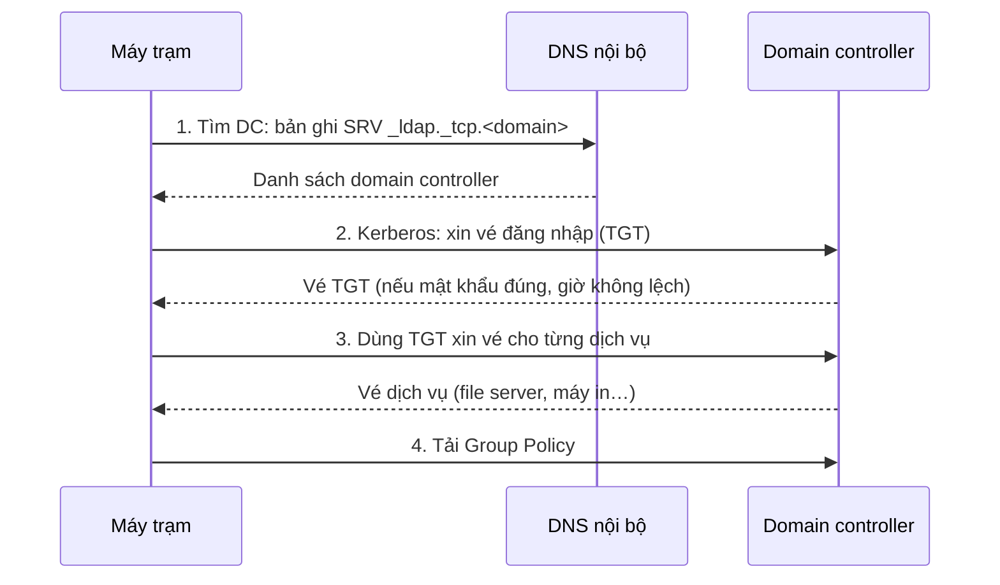

# Windows & Active Directory

Máy trạm, file server và domain. Mở cmd hoặc PowerShell bằng <kbd>Win</kbd>+<kbd>R</kbd>; lệnh quản trị: chuột phải → **Run as administrator**.

> Hiểu một lần đăng nhập domain diễn ra thế nào; sửa máy mất liên kết domain mà không phải gỡ ra; tìm máy đang làm khoá tài khoản; xem ai đang giữ file trên file server.

<p class="related">Liên quan: <a href="#/xu-ly-su-co?id=su-co-6">Không đăng nhập domain</a> · <a href="#/xu-ly-su-co?id=su-co-4">Thư mục chia sẻ</a> · <a href="#/xu-ly-su-co?id=su-co-5">Máy in</a> · <a href="#/mang?id=luong-ket-noi">DNS trong luồng kết nối</a></p>

## Hiểu :id=hieu

### Một lần đăng nhập domain :id=dang-nhap-domain



| Bước | Hỏng thì | Kiểm tra |
|---|---|---|
| 1 · Tìm DC qua DNS | Không join domain, không đăng nhập được: máy dùng **DNS công cộng** không có bản ghi của domain | `nslookup -type=SRV _ldap._tcp.dc._msdcs.<domain>` |
| 2 · Kerberos | Sai mật khẩu, tài khoản bị khoá, **giờ lệch quá 5 phút** | `net user <tên> /domain` · `w32tm /query /status` |
| 3 · Vé dịch vụ | Vừa thêm quyền mà chưa có tác dụng: vé cũ chưa có nhóm mới | `klist` · `klist purge` |
| 4 · Group Policy | Chính sách không áp | `gpresult /r` · `gpupdate /force` |

?> Máy trạm trong domain **phải dùng DNS nội bộ** (thường là chính domain controller). Đặt DNS là `8.8.8.8` thì vào Internet vẫn được nhưng không tìm thấy domain controller.

Group Policy tự làm mới mỗi **90 phút, cộng ngẫu nhiên 0–30 phút**, để hàng trăm máy không cùng hỏi DC một lúc. Muốn áp ngay: `gpupdate /force`.

### Quyền thư mục chia sẻ: hai lớp :id=quyen-chia-se

Người dùng mở `\\server\share\file` phải qua **hai lớp quyền**. Quyền thực tế là lớp **chặt hơn**.

| Lớp | Đặt ở | Ghi chú |
|---|---|---|
| **Share** | Properties → Sharing → Advanced Sharing | Thường để rộng (Authenticated Users: Change) |
| **NTFS** | Properties → Security | Nơi phân quyền chi tiết theo nhóm |

Ví dụ: share cho phép Change, NTFS chỉ cho Read → người dùng chỉ **đọc** được.

## Làm :id=lam

### Sửa lỗi đăng nhập domain :id=sua-dang-nhap

| Việc | Lệnh |
|---|---|
| Máy còn liên kết domain không | `nltest /sc_verify:<tên-domain>` |
| **Sửa mất liên kết domain, không cần gỡ ra join lại** | `Test-ComputerSecureChannel -Repair -Credential (Get-Credential)` |
| Đồng bộ lại giờ | `w32tm /resync` |
| Xoá vé Kerberos cũ (vừa được thêm quyền) | `klist purge` rồi đăng xuất, đăng nhập lại |
| Áp lại Group Policy | `gpupdate /force` |

?> Lỗi *"The trust relationship between this workstation and the primary domain failed"*: cách cũ là gỡ máy khỏi domain rồi join lại, mất profile và thời gian. `Test-ComputerSecureChannel -Repair` (chạy bằng quyền quản trị cục bộ, nhập tài khoản domain admin) sửa tại chỗ trong vài giây. Lệnh có trong Windows PowerShell 5.1 (`powershell`), không có trong PowerShell 7 (`pwsh`).

### Tìm máy đang làm khoá tài khoản :id=tim-may-gay-khoa

Mở khoá xong lại bị khoá: có một máy đang liên tục gửi mật khẩu cũ.

```powershell
$pdc = (Get-ADDomain).PDCEmulator
Get-WinEvent -ComputerName $pdc -FilterHashtable @{LogName='Security'; Id=4740} -MaxEvents 20 |
  Select-Object TimeCreated, @{n='User';e={$_.Properties[0].Value}}, @{n='Từ máy';e={$_.Properties[1].Value}}
```

Event **4740** ghi tên máy gửi mật khẩu sai. Thủ phạm hay gặp: điện thoại còn lưu mật khẩu email cũ, ổ mạng đã gắn bằng mật khẩu cũ, dịch vụ hoặc tác vụ định kỳ chạy bằng tài khoản người dùng.

### File server: ai đang giữ file :id=file-server

Người dùng báo *"file đang được người khác mở"*. Trên file server:

```powershell
Get-SmbOpenFile | Where-Object Path -like "*<tên-file>*" | Select-Object ClientUserName, ClientComputerName, Path, FileId
Close-SmbOpenFile -FileId <id>          # đóng file đó (người đang mở có thể mất phần chưa lưu)
```

### Chép dữ liệu lớn: robocopy :id=robocopy

```bat
robocopy <nguồn> <đích> /E /Z /MT:16 /R:2 /W:5 /LOG:C:\robocopy.log
```

| Tham số | Ý nghĩa |
|---|---|
| `/E` | Chép cả thư mục con, kể cả thư mục rỗng |
| `/Z` | Đứt mạng thì chép tiếp từ chỗ dừng |
| `/MT:16` | Chép 16 luồng song song (mặc định 8), nhanh hơn nhiều với nhiều file nhỏ |
| `/R:2 /W:5` | Lỗi thì thử lại 2 lần, cách 5 giây (mặc định: 1 triệu lần, cách 30 giây) |
| `/MIR` | Đồng bộ y hệt: **xoá** ở đích những gì nguồn không có |
| `/L` | Chỉ liệt kê sẽ làm gì, không chép, không xoá |

!> `/MIR` với nguồn và đích bị đảo ngược sẽ **xoá sạch dữ liệu thật**. Luôn chạy thử với `/L` trước.

### Máy in kẹt lệnh in :id=may-in-ket

```bat
net stop spooler
del /Q %systemroot%\System32\spool\PRINTERS\*
net start spooler
```

### DHCP server hết IP :id=dhcp-server

```powershell
Get-DhcpServerv4ScopeStatistics            # mỗi dải IP đã dùng bao nhiêu %
Get-DhcpServerv4Lease -ScopeId <dải>       # máy nào đang giữ IP nào
```

Dải dùng gần 100% → máy mới nhận `169.254.x.x`. Rút ngắn thời gian thuê IP hoặc mở rộng dải.

## Tra :id=tra

### Mạng :id=mang

| Việc | Lệnh |
|---|---|
| IP, gateway, DNS, MAC | `ipconfig /all` |
| Xin lại IP · xoá cache DNS | `ipconfig /release` → `ipconfig /renew` · `ipconfig /flushdns` |
| Thử kết nối tới cổng | `Test-NetConnection <ip> -Port 445` |
| Đường đi kèm tỉ lệ mất gói | `pathping <ip>` |
| Cổng đang mở kèm PID | `netstat -ano \| findstr LISTENING` |
| Chương trình của một PID | `tasklist /FI "PID eq <pid>"` |
| **Báo cáo lịch sử Wi-Fi** (rớt lúc nào, vì sao) | `netsh wlan show wlanreport` |
| Đặt lại cấu hình mạng (khi đã thử mọi cách) | `netsh winsock reset` · `netsh int ip reset` |

?> `netsh wlan show wlanreport` tạo file `C:\ProgramData\Microsoft\Windows\WlanReport\wlan-report-latest.html`, ghi lại từng lần mất Wi-Fi trong 3 ngày: bằng chứng cụ thể khi người dùng than "Wi-Fi hay rớt".

### Máy & hệ thống :id=he-thong

| Việc | Lệnh |
|---|---|
| Thông tin máy, ngày cài, bản vá | `systeminfo` |
| Tên máy · tài khoản và nhóm | `hostname` · `whoami /groups` |
| Tắt tiến trình | `taskkill /PID <pid> /F` · `taskkill /IM <tên>.exe /F` |
| Sửa file hệ thống (DISM trước, sfc sau) | `DISM /Online /Cleanup-Image /RestoreHealth` · `sfc /scannow` |
| Kiểm tra ổ đĩa (khi khởi động lại) | `chkdsk C: /f` |
| Khởi động lại ngay | `shutdown /r /t 0` |

### Mở nhanh công cụ (Win+R) :id=cong-cu

| Gõ | Mở | Gõ | Mở |
|---|---|---|---|
| `ncpa.cpl` | Card mạng | `dsa.msc` | AD Users and Computers |
| `services.msc` | Dịch vụ | `gpmc.msc` | Quản lý Group Policy |
| `eventvwr.msc` | Nhật ký sự kiện | `dnsmgmt.msc` | DNS server |
| `compmgmt.msc` | Ổ đĩa, user, thư mục chia sẻ | `dhcpmgmt.msc` | DHCP server |
| `devmgmt.msc` | Thiết bị, driver | `fsmgmt.msc` | Thư mục chia sẻ, phiên đang mở |

### Active Directory (PowerShell) :id=active-directory

| Việc | Lệnh |
|---|---|
| Thông tin tài khoản | `Get-ADUser <tên> -Properties LockedOut, LastLogonDate, PasswordExpired` |
| Mọi tài khoản đang bị khoá | `Search-ADAccount -LockedOut` |
| Mở khoá | `Unlock-ADAccount <tên>` |
| Đặt lại mật khẩu | `Set-ADAccountPassword <tên> -Reset -NewPassword (Read-Host -AsSecureString "Mật khẩu mới")` |
| Bắt đổi mật khẩu khi đăng nhập | `Set-ADUser <tên> -ChangePasswordAtLogon $true` |
| Thành viên nhóm · thêm vào nhóm | `Get-ADGroupMember "<nhóm>"` · `Add-ADGroupMember "<nhóm>" -Members <tên>` |
| Tài khoản 90 ngày không đăng nhập | `Search-ADAccount -AccountInactive -TimeSpan 90.00:00:00 -UsersOnly` |

Chạy trên domain controller hoặc máy đã cài RSAT.

### File server :id=tra-file-server

| Việc | Lệnh |
|---|---|
| Gắn ổ mạng | `net use Z: \\<server>\<share> /persistent:yes` |
| Ai đang kết nối vào server | `Get-SmbSession` |
| Danh sách thư mục chia sẻ | `Get-SmbShare` |

## Tự kiểm tra :id=tu-kiem-tra

<details>
<summary>Máy mới không join được domain, báo không tìm thấy domain. Kiểm tra gì đầu tiên?</summary>

DNS của máy. Máy phải dùng DNS nội bộ để tìm bản ghi SRV của domain controller: `ipconfig /all`, rồi `nslookup -type=SRV _ldap._tcp.dc._msdcs.<domain>`.

</details>

<details>
<summary>Người dùng vừa được thêm vào nhóm có quyền nhưng mở thư mục vẫn bị từ chối. Vì sao, xử lý thế nào?</summary>

Vé Kerberos đang dùng được cấp trước khi thêm nhóm nên chưa có nhóm mới. Đăng xuất rồi đăng nhập lại, hoặc `klist purge`.

</details>

<details>
<summary>Thư mục chia sẻ: Share cho Everyone Full Control, NTFS cho nhóm Kế toán Read. Kế toán làm được gì?</summary>

Chỉ **đọc**. Quyền thực tế là lớp chặt hơn của hai lớp.

</details>

<details>
<summary>Tài khoản bị khoá lại sau mỗi 15 phút. Tìm nguyên nhân bằng cách nào?</summary>

Xem event 4740 trên domain controller giữ vai trò PDC emulator; trường thứ hai cho biết máy gửi mật khẩu sai. Thường là điện thoại hoặc ổ mạng còn lưu mật khẩu cũ.

</details>

## Cần nhớ :id=can-nho

1. Đăng nhập domain cần **DNS nội bộ** (tìm DC) và **giờ không lệch quá 5 phút** (Kerberos).
2. Tài khoản bị khoá lặp lại: xem **event 4740** trên PDC để biết máy nào gửi mật khẩu sai.
3. `robocopy /MIR` xoá ở đích những gì nguồn không có: luôn chạy thử với `/L` trước.

## Nguồn tham khảo :id=nguon

- Microsoft Learn — [Locating domain controllers](https://learn.microsoft.com/en-us/windows-server/identity/ad-ds/manage/dc-locator) · [Kerberos authentication overview](https://learn.microsoft.com/en-us/windows-server/security/kerberos/kerberos-authentication-overview) · [Maximum tolerance for computer clock synchronization](https://learn.microsoft.com/en-us/previous-versions/windows/it-pro/windows-10/security/threat-protection/security-policy-settings/maximum-tolerance-for-computer-clock-synchronization) · [Periodic refresh of Group Policy](https://learn.microsoft.com/en-us/previous-versions/windows/it-pro/windows-2000-server/cc978270(v=technet.10))
- Microsoft Learn — [Windows commands](https://learn.microsoft.com/en-us/windows-server/administration/windows-commands/windows-commands) · [robocopy](https://learn.microsoft.com/en-us/windows-server/administration/windows-commands/robocopy) · [netsh](https://learn.microsoft.com/en-us/windows-server/administration/windows-commands/netsh) · [klist](https://learn.microsoft.com/en-us/windows-server/administration/windows-commands/klist) · [nltest](https://learn.microsoft.com/en-us/previous-versions/windows/it-pro/windows-server-2012-r2-and-2012/cc731935(v=ws.11))
- Microsoft Learn — [Test-ComputerSecureChannel](https://learn.microsoft.com/en-us/powershell/module/microsoft.powershell.management/test-computersecurechannel?view=powershell-5.1) · [ActiveDirectory module](https://learn.microsoft.com/en-us/powershell/module/activedirectory/) · [Get-SmbOpenFile](https://learn.microsoft.com/en-us/powershell/module/smbshare/get-smbopenfile) · [Get-DhcpServerv4ScopeStatistics](https://learn.microsoft.com/en-us/powershell/module/dhcpserver/get-dhcpserverv4scopestatistics) · [Event 4740](https://learn.microsoft.com/en-us/previous-versions/windows/it-pro/windows-10/security/threat-protection/auditing/event-4740)
