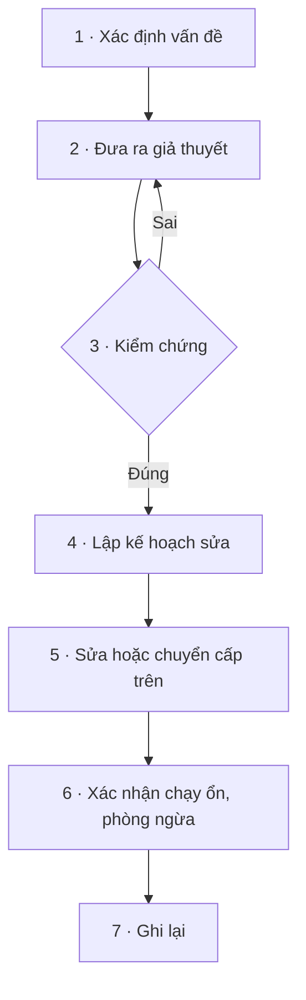

# Xử lý sự cố

Quy trình chuẩn và các bước kiểm tra cụ thể cho 10 sự cố hay gặp nhất ở văn phòng và nhà máy.

> Xử lý sự cố theo quy trình thay vì đoán mò; khoanh vùng lỗi trong vài phút; viết được báo cáo sự cố đúng chuẩn.

## Chọn theo triệu chứng :id=chon

| Máy trạm & mạng | Tài khoản, server, thiết bị |
|---|---|
| [1 · Một máy không vào mạng](xu-ly-su-co.md?id=su-co-1) | [6 · Không đăng nhập được domain](xu-ly-su-co.md?id=su-co-6) |
| [2 · Cả khu mất mạng, mạng chậm](xu-ly-su-co.md?id=su-co-2) | [7 · Server Linux đầy ổ](xu-ly-su-co.md?id=su-co-7) |
| [3 · Vào bằng IP được, bằng tên không](xu-ly-su-co.md?id=su-co-3) | [8 · Server chậm](xu-ly-su-co.md?id=su-co-8) |
| [4 · Không vào được thư mục chia sẻ](xu-ly-su-co.md?id=su-co-4) | [9 · Web nội bộ không truy cập được](xu-ly-su-co.md?id=su-co-9) |
| [5 · Máy in không in](xu-ly-su-co.md?id=su-co-5) | [10 · Camera mất hình](xu-ly-su-co.md?id=su-co-10) |

Chưa rõ thuộc loại nào: làm theo [quy trình 7 bước](xu-ly-su-co.md?id=quy-trinh).

## Quy trình 7 bước (CompTIA) :id=quy-trinh



| Bước | Làm gì |
|---|---|
| 1 · Xác định vấn đề | Hỏi người dùng, xem triệu chứng, **vừa thay đổi gì không**, ảnh hưởng mấy người |
| 2 · Giả thuyết | Bắt đầu từ nguyên nhân đơn giản nhất. Kiểm tra từ dưới lên (dây → IP → DNS → ứng dụng) |
| 3 · Kiểm chứng | Dùng lệnh để xác nhận. Sai thì quay lại bước 2 |
| 4 · Kế hoạch | Sửa thế nào, ảnh hưởng ai, sửa lúc nào, quay lại được không |
| 5 · Thực hiện | Sửa, hoặc chuyển cho người có quyền / có chuyên môn hơn |
| 6 · Xác nhận | Người dùng xác nhận đã dùng được; thêm biện pháp để không lặp lại |
| 7 · Ghi lại | Triệu chứng, nguyên nhân, cách xử lý, bài học |

**Khoanh vùng theo phạm vi ảnh hưởng:**

| Phạm vi | Nghi ngờ trước |
|---|---|
| Một máy | Máy đó: dây, card mạng, cấu hình, tài khoản |
| Một phòng / một khu | Switch của khu đó, dây uplink, VLAN |
| Cả nhà máy | Core switch, firewall, DHCP/DNS server, đường Internet, điện |
| Một ứng dụng, mọi người | Server của ứng dụng đó |

## 1. Một máy không vào được mạng :id=su-co-1

Làm theo [quy trình kiểm tra 5 bước](mang.md?id=kiem-tra-5-buoc).

| Hay gặp | Kiểm tra | Xử lý |
|---|---|---|
| Dây lỏng, đứt | Đèn cổng mạng | Thay dây, đổi cổng |
| Cổng switch bị err-disabled | `show interfaces status err-disabled` | Sửa nguyên nhân, `shutdown` → `no shutdown` |
| **Trùng IP** | Windows báo *IP address conflict*, System log event **4199** | Tìm máy trùng: `arp -a`, Wireshark lọc `arp.duplicate-address-detected` |
| Cổng switch sai VLAN | `show interfaces status` | `switchport access vlan <đúng>` |

Tìm máy đang cắm ở cổng nào: lấy MAC bằng `ipconfig /all`, trên switch chạy `show mac address-table address <mac>`.

?> **Báo trùng IP giả với địa chỉ `0.0.0.0`** (event 4199), máy không nhận được IP dù DHCP vẫn chạy, log DHCP server đầy `BAD_ADDRESS`: không phải trùng IP thật. Tính năng **IP Device Tracking** của switch Cisco gửi gói ARP dò đúng lúc Windows đang kiểm tra trùng địa chỉ. Cách xử lý theo [Microsoft](https://learn.microsoft.com/en-us/troubleshoot/windows-server/networking/event-4199-windows-client-cannot-get-ip-address-dhcp-server) và [Cisco](https://www.cisco.com/c/en/us/support/docs/ios-nx-os-software/8021x/116529-problemsolution-product-00.html): tắt tính năng này hoặc cho switch gửi gói dò chậm lại.

## 2. Cả một khu vực mất mạng hoặc rất chậm :id=su-co-2

1. Mọi máy trong khu cùng bị? Có chung **một switch**?
2. Ra tủ mạng: switch có điện, đèn uplink có sáng không.
3. Trên core: `show interfaces status` → cổng xuống khu đó có `connected`?
4. `show logging` → cổng lên xuống liên tục (flapping) hay thông báo về spanning tree.

!> Cả mạng chậm bất thường, đèn switch nháy liên tục: nghi **loop** (có người cắm hai đầu một sợi dây vào cùng switch, hoặc cắm switch mini thành vòng). Rút từng dây uplink của khu nghi ngờ cho tới khi mạng trở lại bình thường.

**Tìm nơi gây loop** trên Cisco:

```
show spanning-tree detail | include ieee|occurr|from|is exec
```

Kết quả cho biết topology thay đổi bao nhiêu lần, lần cuối cách đây bao lâu, **từ cổng nào**. Đi theo cổng đó tới switch kế tiếp, lặp lại cho tới khi tìm ra nguồn.

## 3. Vào được bằng IP, không vào được bằng tên :id=su-co-3

```bat
nslookup <tên-server>
nslookup <tên-server> <ip-dns-nội-bộ>
ipconfig /flushdns
```

| Hay gặp | Dấu hiệu |
|---|---|
| Máy dùng DNS công cộng (8.8.8.8) | Lệnh 1 lỗi, lệnh 2 (chỉ định DNS nội bộ) chạy được |
| DNS server nội bộ dừng | Cả lệnh 1 và 2 đều lỗi |
| Bản ghi DNS sai | Trả về IP cũ |

## 4. Không vào được thư mục chia sẻ :id=su-co-4

| # | Kiểm tra | Lệnh |
|---|---|---|
| 1 | Server còn sống | `ping <server>` |
| 2 | Cổng SMB mở | `Test-NetConnection <server> -Port 445` |
| 3 | Đang kết nối bằng tài khoản nào | `net use` |
| 4 | Tài khoản có bị khoá | `net user <tên> /domain` |
| 5 | Có quyền trên thư mục | Server → thư mục → Properties → Security |

?> Vừa được thêm vào nhóm có quyền mà vẫn bị từ chối: quyền mới chỉ có tác dụng sau khi **đăng xuất rồi đăng nhập lại**, hoặc `klist purge`. Windows nhớ mật khẩu cũ thì xoá trong **Credential Manager**.

Người dùng báo *"file đang được người khác mở"*: trên file server chạy `Get-SmbOpenFile | Where-Object Path -like "*<tên-file>*"` để biết ai đang giữ file.

## 5. Máy in không in :id=su-co-5

1. Máy khác in được không? Được → lỗi ở máy này. Không → lỗi ở máy in.
2. `ping <ip-máy-in>`: không thông → máy in mất mạng hoặc **đổi IP**.
3. Hàng đợi kẹt → [xoá hàng đợi](windows.md?id=may-in-ket).

?> Máy in nên có **IP cố định**, bằng cách đặt IP tĩnh hoặc giữ chỗ (reservation) trên DHCP server. Máy in nhận IP động là nguyên nhân số một của "hôm qua in được, hôm nay không".

## 6. Không đăng nhập được domain :id=su-co-6

| Thông báo / dấu hiệu | Nguyên nhân | Xử lý |
|---|---|---|
| *The referenced account is currently locked out* | Tài khoản bị khoá | `Unlock-ADAccount <tên>`; khoá lại liên tục thì [tìm máy gây khoá](windows.md?id=active-directory) (event 4740) |
| *The trust relationship … failed* | Máy mất liên kết domain | `Test-ComputerSecureChannel -Repair -Credential (Get-Credential)` |
| Báo lỗi thời gian, Kerberos | Giờ máy lệch quá 5 phút | `w32tm /resync`, kiểm tra pin CMOS |
| *Your password has expired* | Hết hạn mật khẩu | `Set-ADAccountPassword` + `-ChangePasswordAtLogon $true` |

## 7. Server Linux đầy ổ :id=su-co-7

```bash
df -h                                          # phân vùng nào đầy
df -i                                          # hay hết inode (quá nhiều file nhỏ)?
sudo du -xh --max-depth=1 / | sort -rh | head  # thư mục nào nặng, đi sâu dần
sudo lsof +L1                                  # file đã xoá nhưng vẫn chiếm chỗ
journalctl --disk-usage
sudo journalctl --vacuum-time=7d
docker system df                               # nếu có Docker
```

| Hay gặp | Xử lý |
|---|---|
| Log không được xoay vòng | Cấu hình logrotate; tạm thời `truncate -s 0` file log |
| Đã `rm` log nhưng dung lượng không giảm | `lsof +L1` → restart tiến trình đang giữ file |
| Backup cũ tích tụ | Xoá theo chính sách lưu trữ, thêm bước tự dọn vào script backup |
| Image, container Docker cũ | `docker system prune` (xem kỹ trước khi đồng ý) |

## 8. Server chậm :id=su-co-8

Làm theo [quy trình 60 giây](linux.md?id=server-60-giay). Dấu hiệu cần chú ý:

| Thấy | Nghĩa là |
|---|---|
| `uptime`: load cao hơn số nhân CPU, kéo dài | Quá tải |
| `vmstat`: cột `wa` cao | Chờ ổ đĩa |
| `vmstat`: `si`, `so` khác 0 | Thiếu RAM, đang dùng swap |
| `dmesg`: `Out of memory: Killed process` | Hết RAM, kernel đã tắt bớt tiến trình |
| `iostat`: `%util` gần 100 | Ổ đĩa quá tải |

## 9. Web / ứng dụng nội bộ không truy cập được :id=su-co-9

```bash
ping <server>                      # 1. server còn sống
nc -zv <server> 443                # 2. cổng mở
curl -I https://<tên-web>          # 3. web trả lời mã gì
```

Trên server: `systemctl status <dịch-vụ>` → `sudo ss -tulpn | grep :443` → `journalctl -u <dịch-vụ> -n 50`.

| Mã HTTP | Nghĩa | Xem tiếp |
|---|---|---|
| 401 / 403 | Chưa đăng nhập / không có quyền | Tài khoản, phân quyền |
| 404 | Sai đường dẫn | URL, cấu hình web server |
| 500 | Lỗi bên trong ứng dụng | Log ứng dụng |
| 502 / 504 | Proxy (nginx) không gọi được ứng dụng phía sau | Ứng dụng đã dừng hoặc quá tải |

## 10. Camera mất hình :id=su-co-10

1. Một camera hay nhiều camera? Nhiều camera chung một switch PoE → xem switch đó.
2. `ping <ip-camera>`: không thông → mất nguồn PoE, dây hoặc camera hỏng.
3. Ping được nhưng đầu ghi không có hình → `Test-NetConnection <ip-camera> -Port 554` (RTSP), kiểm tra tài khoản camera trên đầu ghi.
4. Vừa lắp thêm camera thì vài camera khác tắt → **switch hết công suất PoE**: `show power inline` xem tổng công suất còn lại.

## Mẫu báo cáo sự cố :id=bao-cao

```
Sự cố:        Mất mạng khu xưởng A
Thời gian:    08:15 – 09:02 (47 phút)
Ảnh hưởng:    30 máy, 2 máy chấm công; dây chuyền không bị ảnh hưởng
Nguyên nhân:  Dây uplink từ core xuống switch xưởng A bị xe nâng cán đứt
Xử lý:        Thay dây tạm, chuyển uplink sang cổng dự phòng
Phòng ngừa:   Đi lại dây trong máng bảo vệ; thêm đường uplink thứ hai
Người xử lý:  <tên>
```

## Cần nhớ :id=can-nho

1. Hỏi **phạm vi** trước tiên: một máy, một khu hay cả nhà máy. Phạm vi chỉ ra thiết bị cần nghi ngờ.
2. **Mỗi lần chỉ đổi một thứ**, kiểm tra lại rồi mới làm tiếp; sao lưu trước khi sửa.
3. Sự cố chưa được **ghi lại** thì coi như chưa xử lý xong.

## Nguồn tham khảo :id=nguon

- CompTIA — [A Guide to Network Troubleshooting](https://www.comptia.org/content/guides/a-guide-to-network-troubleshooting)
- Microsoft Learn — [Event 4199 and Windows client can't get an IP address](https://learn.microsoft.com/en-us/troubleshoot/windows-server/networking/event-4199-windows-client-cannot-get-ip-address-dhcp-server) · [Event 4740](https://learn.microsoft.com/en-us/previous-versions/windows/it-pro/windows-10/security/threat-protection/auditing/event-4740) · [Test-ComputerSecureChannel](https://learn.microsoft.com/en-us/powershell/module/microsoft.powershell.management/test-computersecurechannel?view=powershell-5.1) · [Get-SmbOpenFile](https://learn.microsoft.com/en-us/powershell/module/smbshare/get-smbopenfile)
- Brendan Gregg, Netflix — [Linux Performance Analysis in 60,000 Milliseconds](https://netflixtechblog.com/linux-performance-analysis-in-60-000-milliseconds-accc10403c55)
